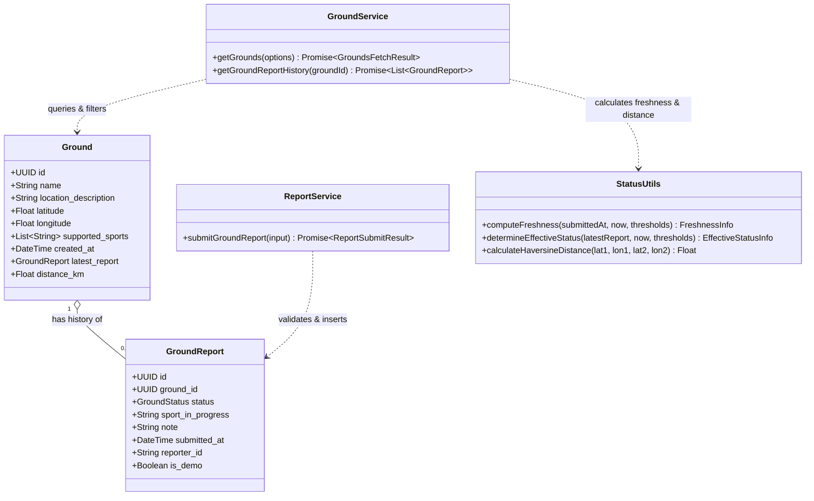
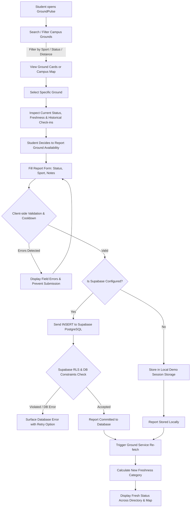

# GroundPulse

> **Find your ground. Know the game.**  
> A student-powered campus sports-ground discovery and availability-reporting platform.

[](LICENSE)
[](#)

---

## 1. Project Overview & Problem Statement

College and university students frequently face frustration trying to play recreational sports:
- Walking across large campuses only to find tennis courts, basketball hoops, or turf fields occupied by intramural teams or club scrimmages.
- Not knowing whether lighting is on, fields are flooded from rain, or games are wrapping up.
- Unreliable rumors and stale chat messages.

**GroundPulse** solves this through a student-driven ground discovery and live crowd-check-in platform. GroundPulse establishes a clear line of transparency:
- **Verified ground data** (facilities, courts, supported sports, lighting) managed in the database.
- **Community-reported availability** (Available, Occupied, Unknown) submitted in seconds by students on the ground.
- **Configurable Freshness Engine** that actively prevents misinformation by decaying older reports so stale status is never masqueraded as live availability.
- **Explicit Anti-Misinformation Guarantee:** GroundPulse does **not** claim to use automated cameras or LiDAR sensors. All live data reflects transparent, student-reported check-ins.

---

## 2. Core Features

### A. Ground Directory
- Responsive cards displaying facility names, supported sports, physical locations, and current availability status.
- Text labels paired with colors for WCAG AA accessibility (never relying on color alone).
- Clean unboxed metadata with subtle typographic separators (`·`).

### B. Intelligent Search & Combined Filters
- Real-time text search querying ground names, sports, and location descriptions.
- Status segmented filter: `All`, `Available`, `Occupied`, `Unknown`.
- Sport selector dynamically populated from grounds.
- Sorting options: **Most Recently Reported**, **Ground Name (A–Z)**, or **Distance (Closest First)** using browser Geolocation.
- Combined filter state management with one-click reset.

### C. Community Availability Reporting
- Fast check-in modal allowing students to submit:
  - Ground selection (pre-selected when clicking from a specific ground card).
  - Status: `Available`, `Occupied`, or `Unknown`.
  - Sport currently being played (e.g. 5v5 Basketball, Soccer scrimmage).
  - Optional short field note (up to 280 characters with live counter).
- Strict client-side and server-side validation.
- Client-side debouncing cooldown to prevent accidental duplicate submissions.

### D. Automated Report Freshness & Anti-Staleness Rules
- **Fresh (<15 minutes):** High confidence that reported conditions still hold.
- **Aging (15–60 minutes):** Moderate confidence; games may be starting or concluding.
- **Stale (>60 minutes):** Automatically demoted to **Unknown / Stale** with an explicit notice to prevent students from walking across campus on outdated data.
- Configurable thresholds via environment variables (`VITE_FRESHNESS_FRESH_MINUTES`, `VITE_FRESHNESS_AGING_MINUTES`).

### E. Ground Details & Chronological Report History
- Detailed view with full facility specifications, supported sports, and GPS coordinates.
- Prominent current effective status banner.
- Complete chronological audit log of past check-ins with timestamps and notes.

### F. Interactive Campus Map
- Leaflet integration with OpenStreetMap tiles.
- Custom color-coded SVG markers showing availability status without relying on external image dependencies.
- Interactive popups linking directly to ground details and reporting.
- Graceful non-GPS fallback: Grounds without fixed coordinates (e.g. open lawns) remain accessible in the directory without fabricating fake map pins.

### G. Safe Demo Mode
- Automatically engages when Supabase credentials are absent.
- Provides realistic, clearly labelled sample campus data.
- Stores test submissions locally in `sessionStorage` without pretending they are shared globally.
- Real database errors in production mode are surfaced transparently with retry buttons.

---

## 3. Screenshots

<!-- Screenshots will be added here -->
| Campus Ground Directory | Interactive Leaflet Map |
| :---: | :---: |
|  |  |

| Availability Report Flow | Facility Details & History |
| :---: | :---: |
|  |  |

---

## 4. Technology Stack & Rationale

| Layer | Technology | Rationale |
| :--- | :--- | :--- |
| **Frontend UI** | React 19 + TypeScript | Type-safe, declarative component model with instant reactivity and zero runtime type errors. |
| **Styling** | Tailwind CSS v4 | High-performance atomic utility CSS following modern typography and anti-slop guidelines. |
| **Icons** | Lucide React | Lightweight, accessible, and consistent SVG icons. |
| **Interactive Map** | Leaflet + OpenStreetMap | Open-source, lightweight map engine with zero mandatory API key requirements or vendor lock-in. |
| **Database & Auth** | Supabase (PostgreSQL) | Robust relational database with Row Level Security (RLS) policies and real-time capabilities. |
| **Testing** | Vitest | Fast unit testing engine with native TypeScript and ESM support. |
| **Build Tool** | Vite | Sub-millisecond HMR and optimized production bundles. |

---

## 5. Repository Structure

```text
groundpulse/
├── index.html                     # HTML5 entry with meta, fonts, and Leaflet CSS
├── package.json                   # Dependencies, scripts, and build configuration
├── vite.config.ts                 # Vite bundler and path aliases
├── tsconfig.json                  # TypeScript compiler options
├── .gitignore                     # Git ignore rules for node_modules, dist, .env
├── .env.example                   # Environment variable template with documentation
├── LICENSE                        # MIT License
├── README.md                      # Comprehensive documentation
├── public/
│   └── favicon.svg                # Geometric pulse SVG icon
├── src/
│   ├── main.tsx                   # React root mount
│   ├── App.tsx                    # Primary application layout and state coordinator
│   ├── index.css                  # Global Tailwind CSS and Leaflet overrides
│   ├── types/
│   │   └── index.ts               # Core TypeScript models and interfaces
│   ├── components/
│   │   ├── Navbar.tsx             # 3-Zone top navigation header
│   │   ├── FilterBar.tsx          # Search, sports, status, and geolocation filters
│   │   ├── GroundCard.tsx         # Responsive ground card with freshness badges
│   │   ├── ReportModal.tsx        # Availability check-in submission form
│   │   ├── GroundDetailModal.tsx  # Facility details and chronological history
│   │   ├── FreshnessRulesModal.tsx# Educational modal explaining trust tiers
│   │   └── DemoBanner.tsx         # Demo mode indicator and connection checker
│   ├── map/
│   │   └── MapView.tsx            # Leaflet interactive map with custom SVG markers
│   ├── services/
│   │   ├── supabaseClient.ts      # Supabase connection manager & credential checker
│   │   ├── groundService.ts       # Ground directory queries, filtering, & distance
│   │   ├── reportService.ts       # Report submission, validation, & cooldown
│   │   └── demoData.ts            # Realistic sample grounds and session storage
│   └── utils/
│       ├── statusUtils.ts         # Freshness calculation & stale status demotion
│       └── validation.ts          # Input sanitization and constraints validation
├── supabase/
│   ├── migrations/
│   │   └── 20261026000000_init_groundpulse.sql # PostgreSQL schema, indexes, and RLS
│   └── seed.sql                   # Realistic sample campus grounds and staggered reports
├── docs/
│   ├── architecture.md            # Technical architecture and design specification
│   ├── class-diagram.mmd          # Mermaid class diagram
│   └── process-flow.mmd           # Mermaid system flow diagram
└── tests/
    ├── statusUtils.test.ts        # Unit tests for freshness, stale demotion, & distance
    └── validation.test.ts         # Unit tests for report validation & input sanitization
```

---

## 6. Architecture & Data Flow

GroundPulse enforces a clear separation of concerns:
1. **Presentation Layer:** Functional React components handle rendering and user events.
2. **Business & Freshness Layer:** Pure utility functions (`statusUtils.ts`, `validation.ts`) calculate time decay, enforce limits, and sanitize inputs.
3. **Service Layer:** `groundService.ts` and `reportService.ts` abstract the data source (Supabase PostgreSQL vs. safe Demo Store).
4. **Database Layer:** Supabase PostgreSQL guarantees data integrity through table constraints and RLS policies.

---

## 7. Class Relationship & Process Flow Diagrams

### Class Diagram



### Process Flow Diagram



---

## 8. Prerequisites

- **Node.js:** v18.0.0 or higher
- **npm:** v9.0.0 or higher
- *(Optional for Production Database)*: Free Supabase account at [supabase.com](https://supabase.com)

---

## 9. Installation

Clone the repository and install dependencies:

```bash
git clone https://github.com/your-username/groundpulse.git
cd groundpulse
npm install
```

---

## 10. Environment Variable Configuration

Copy the example environment template:

```bash
cp .env.example .env
```

Edit `.env` to configure your settings:

```env
# Supabase PostgreSQL Configuration
VITE_SUPABASE_URL="https://your-project-id.supabase.co"
VITE_SUPABASE_ANON_KEY="your-anon-public-key"

# Report Freshness Thresholds (in minutes)
VITE_FRESHNESS_FRESH_MINUTES=15
VITE_FRESHNESS_AGING_MINUTES=60

# Campus Default Map Center
VITE_CAMPUS_DEFAULT_LAT=37.4275
VITE_CAMPUS_DEFAULT_LNG=-122.1697
VITE_CAMPUS_DEFAULT_ZOOM=15
```

> **Note:** If `VITE_SUPABASE_URL` and `VITE_SUPABASE_ANON_KEY` are left empty or omitted, GroundPulse starts in **Demo Mode** automatically.

---

## 11. Supabase Project Setup & SQL Migrations

1. Create a project at [supabase.com](https://supabase.com).
2. Open the **SQL Editor** in your Supabase dashboard.
3. Run the migration script located at:
   ```
   supabase/migrations/20261026000000_init_groundpulse.sql
   ```
4. Seed the initial campus grounds and sample reports:
   ```
   supabase/seed.sql
   ```
5. Copy your **Project URL** and **anon public API key** from **Project Settings > API** into your `.env` file.

---

## 12. Local Development

Run the Vite development server:

```bash
npm run dev
```

Open [http://localhost:3000](http://localhost:3000) in your browser.

---

## 13. Running Tests

Execute the unit test suite with Vitest:

```bash
npm test
```

To run tests in watch mode:

```bash
npx vitest
```

---

## 14. Production Build & Deployment

Build the optimized static assets:

```bash
npm run build
```

Preview the production build locally:

```bash
npm run preview
```

### Static Host Deployment (Vercel, Netlify, Cloudflare Pages, GitHub Pages)
Deploy the generated `dist/` directory directly to any static web host. Ensure `VITE_SUPABASE_URL` and `VITE_SUPABASE_ANON_KEY` are configured in your hosting provider's Environment Variables dashboard.

---

## 15. Security & Row Level Security (RLS)

- **Client Key Safety:** Only the Supabase `anon` public key is used in the frontend. The `service_role` administrative secret is **never** embedded or exposed.
- **Ground Integrity:** Ground records can only be created, modified, or deleted by administrators (or the `service_role`). Public users have read-only access.
- **Report Validation:** Reports are constrained by database checks:
  ```sql
  CONSTRAINT check_valid_status CHECK (status IN ('Available', 'Occupied', 'Unknown'))
  CONSTRAINT check_note_length CHECK (note IS NULL OR char_length(note) <= 280)
  ```
- **Audit Immobility:** Reports cannot be updated by clients (`UPDATE` policy = `false`) to prevent tampering with historical check-in data.
- **Client Debounce:** Client-side 3-second cooldown prevents accidental double submissions.

---

## 16. Demo Mode Behavior

When Supabase environment variables are missing:
- An amber **Demo Mode** indicator is displayed in the navigation and banner.
- Sample grounds with varied freshness states are loaded.
- Submissions are stored in browser `sessionStorage`, updating the UI instantly.
- Clear messaging informs the user that demo check-ins are local to their browser session.

---

## 17. Known Limitations & Future Improvements

| Area | Current Implementation | Planned Improvement |
| :--- | :--- | :--- |
| **Abuse Prevention** | Client cooldown + database length/status checks | Server-side IP rate limiting using Cloudflare Turnstile or Supabase Edge Functions. |
| **User Identity** | Anonymous crowd check-ins | Optional student SSO (Google / University SAML) to earn verified reporter badges. |
| **Push Notifications** | On-demand polling and manual reload | Web push notifications when a favorite ground transitions to "Available". |
| **Historical Analytics** | Chronological log | Peak occupancy prediction curves by day of week. |

---

## 18. Feature Checklist: Implemented vs. Planned

### Currently Implemented (100% Functional in this Repository)
- [x] Full Campus Ground Directory with card view.
- [x] Real-time search across names, sports, and location descriptions.
- [x] Multi-attribute filtering (Status + Sport) working together.
- [x] Sort by Recently Reported, Name (A–Z), and Distance.
- [x] Browser Geolocation integration with Haversine distance calculations.
- [x] Availability check-in form with validation and character countdown.
- [x] Configurable freshness engine (Fresh <15m, Aging 15–60m, Stale >60m).
- [x] Automatic stale report demotion to Unknown state.
- [x] Chronological report history modal per facility.
- [x] Interactive Leaflet + OpenStreetMap with custom SVG markers and popups.
- [x] Graceful non-GPS ground handling without fake pins.
- [x] Full Supabase PostgreSQL schema with RLS and seed scripts.
- [x] Safe Demo Mode with local session persistence.
- [x] Unit test suite passing with Vitest.

### Planned for Future Milestones
- [ ] University SSO / .edu email verification.
- [ ] Push notifications for ground availability alerts.
- [ ] Photo upload verification of field conditions.

---

## License

This project is licensed under the [MIT License](LICENSE).
